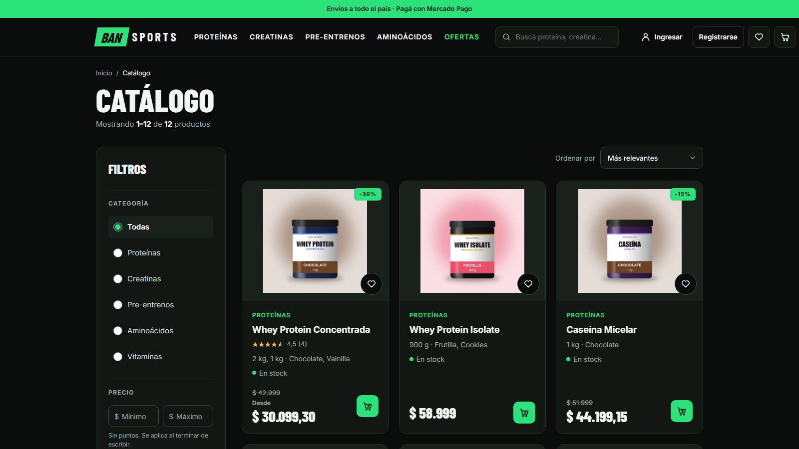
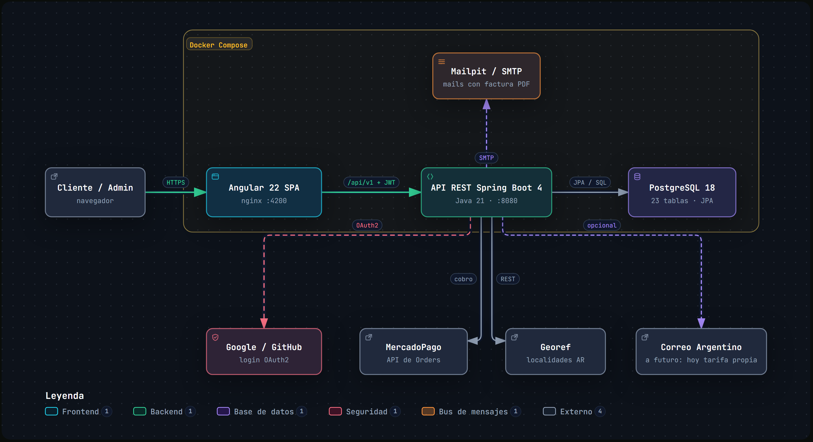
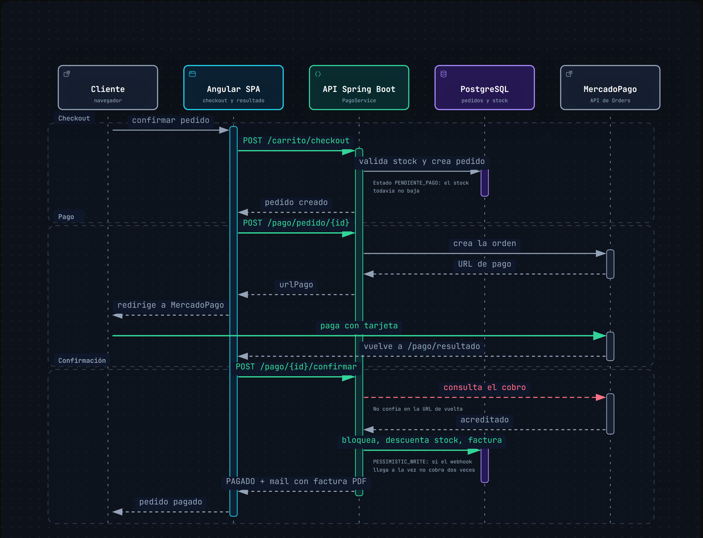
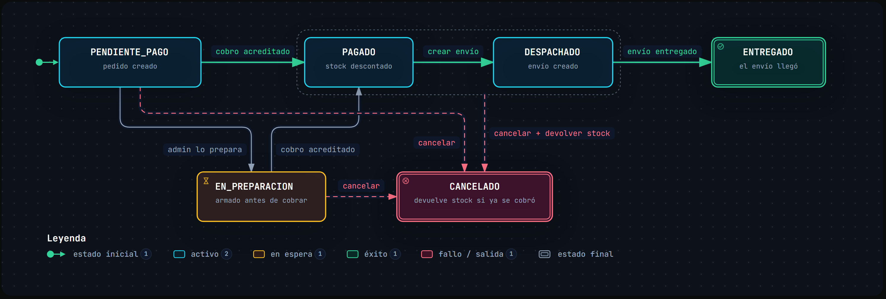
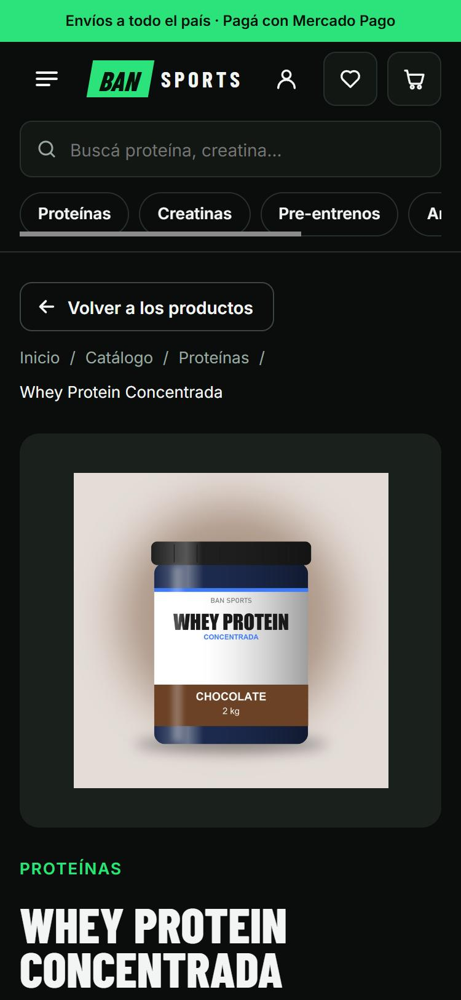

# BAN Sports — Documentación del proyecto

Trabajo Práctico Final de **Programación IV** (2026), Comisión 2 — UTN Mar del Plata.
Prof. Lucrecia Bazán · Ayudante Jonathan Cabrera.
Integrantes: **Alan Arruti, Iara Blandi y Octavio Noval**.

Este documento explica qué hace el sistema, cómo está construido y por qué se tomó cada decisión.
Para instalarlo y correrlo, ver el [README](../README.md).

---

## 1. Qué es

BAN Sports es una tienda online de suplementos deportivos. Tiene dos usuarios:

| Rol | Qué puede hacer |
|---|---|
| **Invitado** | Ver el catálogo, filtrar, buscar, ver el detalle y armar un carrito que se guarda en el navegador. |
| **Cliente** | Todo lo anterior, más comprar: direcciones, cotización del envío, cupones, pago con MercadoPago, factura en PDF por mail, historial de pedidos, favoritos, reseñas y perfil. Puede ingresar con email o con Google y GitHub. |
| **Administrador** | Un panel aparte para gestionar productos, variantes, stock, categorías, cupones, clientes, administradores, pedidos y envíos, con métricas y alertas de stock bajo. |

El frontend es una SPA en **Angular 22** que consume, por HTTP, la API REST en **Spring Boot** desarrollada en Programación III.



---

## 2. Cumplimiento de la consigna

| Requisito mínimo | Cómo se cumple |
|---|---|
| 1. Íntegramente en Angular 22 | `@angular/core` 22.2, componentes standalone, sin ningún `NgModule`. |
| 2. Al menos dos CRUD | Siete: productos, variantes, categorías, cupones, clientes, administradores y pedidos/envíos. |
| 3. Login con distintos roles | `CLIENTE` y `ADMIN`, con pantallas de ingreso separadas (`/login` y `/admin/login`). |
| 4. Guards por rol | `rolGuard('CLIENTE')`, `rolGuard('ADMIN')`, `guestGuard` y `sinAdminGuard`. |
| 5. HTTP contra el backend de Programación III | 16 services con `HttpClient` contra la API Spring Boot. No se usa json-server ni ningún simulador. |
| 6. Commits reales de cada integrante | Repositorio en GitHub con commits de los tres integrantes. |
| 7. Presentar y exponer | Presentación y demo en vivo. |

| Para nota de 7 a 10 | Evidencia |
|---|---|
| Funcionalidad elevada | Pagos con MercadoPago, factura PDF por mail, cupones, reseñas, favoritos, cotización de envío por provincia, recuperación de contraseña, login social. |
| Diseño visual destacado | Sistema de diseño propio (colores y tipografías en `styles/variables.css`), gráfico de ventas del panel en SVG propio. |
| Responsive | La tienda se adapta a celular sin scroll horizontal (ver sección 7). |
| Documentación y README | Este documento, el README del repositorio y los diagramas de la sección 3. |

---

## 3. Arquitectura



- **nginx** sirve el build de Angular y reenvía `/api` y el login social al backend. Así el navegador habla con un solo origen y no hay problemas de CORS en producción.
- **Backend en capas**: `Controller → IService → Service → Repository`, organizado por funcionalidad (`producto/`, `pedido/`, `pago/`…). Los controllers dependen de interfaces, no de implementaciones.
- **DTOs como records**: la API nunca expone entidades. MapStruct convierte entidad ↔ DTO en tiempo de compilación.
- **Todo corre en Docker Compose**: frontend, API, PostgreSQL y Mailpit con un solo comando.
- **Cotización del envío**: hoy se calcula con una tabla propia de tarifas por provincia (con una tarifa por defecto para el resto del país). La integración con la API de Correo Argentino está programada, pero no se activó porque Correo no entregó las credenciales; cuando se configuren, el back la usa primero y vuelve a la tabla propia si Correo no responde.

Los tres diagramas de este documento se generaron a partir del código del repositorio y se validaron contra él (cada caja cita el archivo y las líneas que la respaldan).

---

## 4. Frontend en Angular 22

### Estructura

```
frontend/src/app/
├── page/          31 pantallas (una carpeta por ruta)
├── componente/    21 componentes reutilizables (header, tarjeta de producto, formulario de dirección…)
├── services/      16 services, uno por recurso de la API
├── guards/        rolGuard, guestGuard, sinAdminGuard
├── interceptors/  authInterceptor, conexionInterceptor
├── validaciones/  validadores propios, mensajes y traducción de errores del back
├── pipes/         precio (formato argentino) y promedio (reseñas)
└── models/        interfaces de los datos de la API
```

### Decisiones y por qué

| Decisión | Por qué |
|---|---|
| **Componentes standalone**, sin `NgModule` | Es el modelo actual de Angular: cada componente declara lo que usa y se puede cargar solo. |
| **Signals** para el estado (`signal`, `computed`, `effect`) | El estado que se muestra (sesión, carrito, rol, filtros) se deriva solo y la vista se actualiza sin suscripciones manuales. `AuthService.usuario` es un `computed` que sale del token. |
| **RxJS** para lo asíncrono | HTTP, y `debounceTime` + `switchMap` en los buscadores para no pedir al back en cada tecla. |
| **`@if` / `@for`** en las plantillas | El control de flujo nuevo; no hay ningún `*ngIf`. |
| **Formularios reactivos** | Validación declarativa y testeable. Todos los formularios usan `FormGroup`/`FormControl`. |
| **Carga diferida** (`loadComponent`) | 28 de las 35 rutas se descargan recién al entrar, así la primera carga es liviana. |
| **Guards e interceptors funcionales** | Menos código que las clases y se componen fácil (`rolGuard('ADMIN')`). |
| **Un service por recurso** | Los componentes nunca hacen HTTP directo; la URL y el manejo de errores están en un solo lugar. |

### Sesión y seguridad en el front

1. Al ingresar, el back devuelve un **JWT**. Se guarda en `localStorage` si el usuario marca "mantener la sesión", o en `sessionStorage` si no.
2. Al abrir la app, `provideAppInitializer` valida el token guardado contra el back **antes** de mostrar nada.
3. `authInterceptor` agrega `Authorization: Bearer …` solo a los pedidos a nuestra API. Si el back responde **401**, cierra la sesión y manda al login correspondiente, guardando a dónde quería ir (`?redirect=`).
4. Los **guards** deciden la navegación: sin sesión → login; un cliente en `/admin` → vuelve a la tienda; un admin en la tienda → va a su panel.

> El guard mejora la experiencia, pero **no es la seguridad**: la seguridad real está en el back. Aunque alguien edite el token en el navegador, la firma deja de coincidir y la API responde 401.

### Validaciones

- Validadores propios en `validaciones/validadores.ts` (solo letras, DNI de 7 u 8 números, email con dominio, código postal, precio en formato argentino…).
- Un mensaje por error en `validaciones/mensajes.ts`, que dice qué está mal y cómo corregirlo. Nunca "campo inválido".
- `validaciones/errores-api.ts` traduce los errores del back a mensajes para el usuario.
- Las mismas reglas se validan **otra vez en el back**, para que no se puedan saltear llamando a la API directo.

### Carrito de invitado

El carrito sin sesión se guarda en `localStorage`. Al iniciar sesión se **fusiona** con el carrito de la cuenta en el back y se avisa qué no se pudo sumar por falta de stock.

---

## 5. Flujo principal: compra y pago



| Paso | Qué pasa |
|---|---|
| Checkout | El back valida stock y **recalcula** precios y envío (no confía en lo que manda el front). El pedido queda en `PENDIENTE_PAGO` y el stock **todavía no baja**. |
| Iniciar pago | El back crea la orden en MercadoPago y devuelve la URL de pago. |
| Pagar | El cliente paga en MercadoPago y vuelve a `/pago/resultado`. |
| Confirmar | El back **consulta a MercadoPago** si el cobro está acreditado; no confía en la URL de vuelta. |
| Acreditar | Bloquea la fila del pedido, controla que el monto cubra el total, descuenta stock, genera la factura y pasa a `PAGADO`. Llega el mail con la factura en PDF. |

**Por qué así:**
- El stock baja recién al cobrar, para que un pedido sin pagar no retenga unidades.
- El aviso de MercadoPago (webhook) y la vuelta del cliente pueden llegar a la vez. El **bloqueo pesimista** sobre el pedido hace que se acredite una sola vez.

---

## 6. Estados del pedido



- A `PAGADO` **solo se llega cobrando**: es el estado que descuenta stock y emite la factura. Cambiarlo a mano devuelve 400.
- El envío solo se crea con el pedido `PAGADO` y sigue `DESPACHADO → EN_CAMINO → ENTREGADO`.
- Se puede cancelar hasta `DESPACHADO`. El stock se devuelve solo si ya se había cobrado.

---

## 7. Diseño y responsive

- **Sistema de diseño propio**: colores y tipografías centralizados en `frontend/src/styles/variables.css` (verde `#2be37a` sobre negro, Barlow Condensed para títulos e Inter para texto). El texto sobre verde usa un tono oscuro para cumplir contraste AA.
- **Responsive**: en celular el menú se pliega, el buscador ocupa todo el ancho y las categorías se deslizan de costado. La tienda se verificó a 375 px de ancho sin scroll horizontal. El panel de administración tiene estilos para pantallas chicas en 12 de sus 14 pantallas.
- **Gráfico de ventas** del panel dibujado con SVG propio a partir de signals (`componente/grafico-ventas`), sin librerías externas.
- **Estados de error**: aviso cuando se cae la conexión o el servidor (`conexionInterceptor`) y mensajes de error específicos para cada caso.



---

## 8. Seguridad (verificada)

Pruebas corridas contra la API levantada en Docker:

| Prueba | Respuesta |
|---|---|
| Pedir pedidos sin token | 401 |
| Token con la firma alterada | 401 |
| Token de cliente editado a mano a rol ADMIN | 401 |
| Cliente que pide los datos de otro cliente | 403 |
| Cliente que entra a un endpoint de admin | 403 |
| Cinco contraseñas mal seguidas | Bloqueo por 15 minutos |
| Registro por API con DNI con letras | 400 con el motivo |

Además: contraseñas con BCrypt, JWT sin sesión en el servidor, recuperación de contraseña con token de un solo uso que vence a los 30 minutos y se guarda hasheado.

---

## 9. Tests

| | Cantidad | Herramientas | Qué cubren |
|---|---|---|---|
| Backend | 318 unitarios + 1 de integración | JUnit 5, Mockito, AssertJ, Testcontainers | Services (pedidos, pagos, cupones, stock, auth), pasarela de pago, validación del código postal, filtro JWT. |
| Frontend | 83 | Jasmine, Karma | Guards, interceptor, sesión, validadores, mensajes de error, formularios del panel. |

Cómo correrlos: ver la sección "Tests" del [README](../README.md#tests).

---

## 10. Limitaciones conocidas y próximos pasos

| Limitación | Mejora posible |
|---|---|
| El esquema de la base se actualiza con `ddl-auto: update`. | Migraciones versionadas con Flyway. |
| El bloqueo por intentos fallidos vive en memoria. | Guardarlo en Redis para que sobreviva reinicios y sirva con varias instancias. |
| Los mails se mandan dentro del mismo pedido HTTP. | Mandarlos en segundo plano con una cola. |
| La factura no es un comprobante fiscal (no tiene CAE de ARCA). | Integrar la facturación electrónica. |
| El código postal se valida contra la provincia, no contra la localidad exacta. | Usar una tabla oficial de códigos postales si se consigue. |

Para el **Trabajo Final Integrador**, la consigna pide sumar cuatro requisitos funcionales adicionales, que el grupo definirá y documentará.
